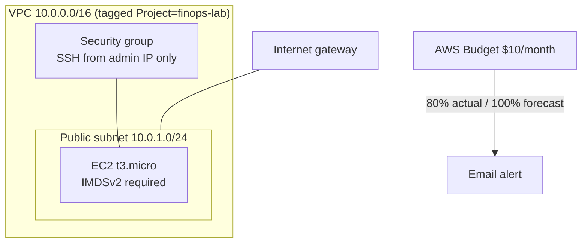

# AWS Cloud & FinOps Governance Lab

A small AWS environment built with the AWS CLI (from the AWS re/Start labs), with least-privilege IAM, cost-allocation tags on every resource, and a monthly budget with alerts.



## What's inside

| Path | Purpose |
| --- | --- |
| `scripts/setup_vpc_ec2.sh` | Creates VPC, subnet, internet gateway, route table, security group and one EC2 instance. Every resource is tagged `Project`, `Owner`, `Environment`. |
| `scripts/cleanup.sh` | Deletes everything in the right order so nothing keeps billing. |
| `scripts/create_budget.sh` | Monthly cost budget with email alerts at 80% of actual spend and 100% of forecast. |
| `iam/ec2-operator-least-privilege.json` | Can view EC2, start/stop only instances tagged `Project=finops-lab`, and is blocked from launching anything bigger than `t3.small`. |
| `iam/billing-viewer.json` | Read-only access to Cost Explorer and Budgets for reporting. |
| `.github/workflows/ci.yml` · `.gitlab-ci.yml` | `shellcheck`, JSON validation and a Trivy secret scan on every push (GitHub Actions and GitLab CI). |

## Run it

Requires the AWS CLI configured with an account you own (`aws configure`).

```bash
# 1. Budget first, so you are alerted before anything costs money
ALERT_EMAIL=you@example.com LIMIT_USD=10 ./scripts/create_budget.sh

# 2. Build the environment
MY_IP=$(curl -s https://checkip.amazonaws.com) KEY_NAME=my-key ./scripts/setup_vpc_ec2.sh

# 3. Always clean up after the lab
./scripts/cleanup.sh
```

Then in **Billing → Cost allocation tags**, activate `Project` and `Owner` so Cost Explorer can group spend by them.

## FinOps and security choices

- **Tag everything at creation:** cost can be traced to a project and owner from day one, not cleaned up later.
- **Budget before resources:** the alert exists before the first instance starts.
- **Guardrail in IAM:** the operator role cannot launch expensive instance types, even by mistake.
- **Small attack surface:** SSH only from one IP, IMDSv2 enforced, no access keys in the repo (checked by the secret scan).

## What I learned

<!-- Write 3-4 lines in your own words: what surprised you about AWS billing, what you would automate next. -->
